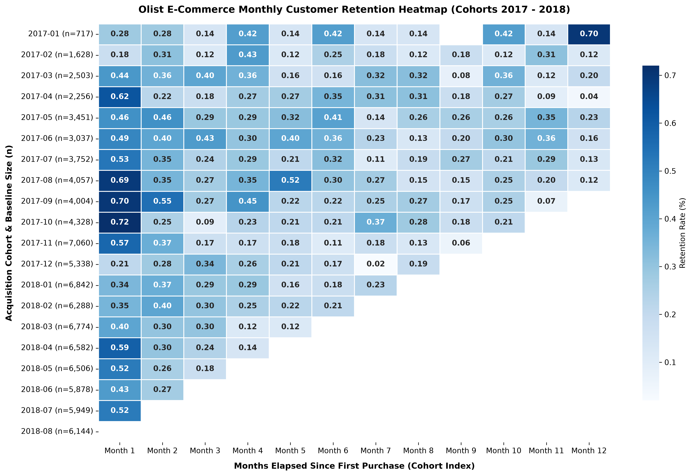
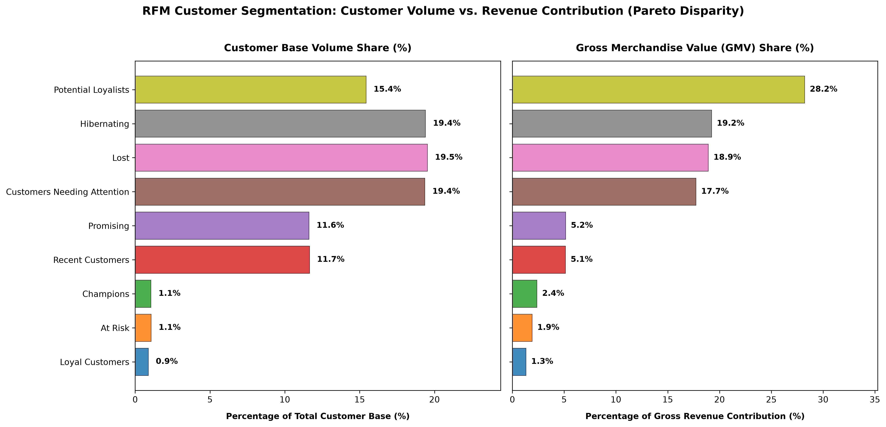
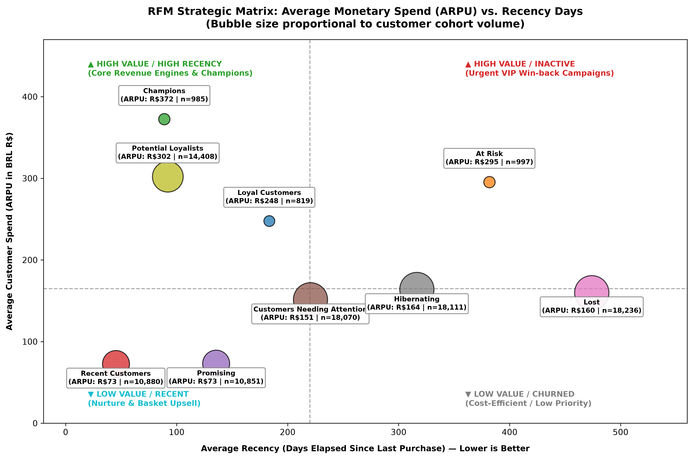
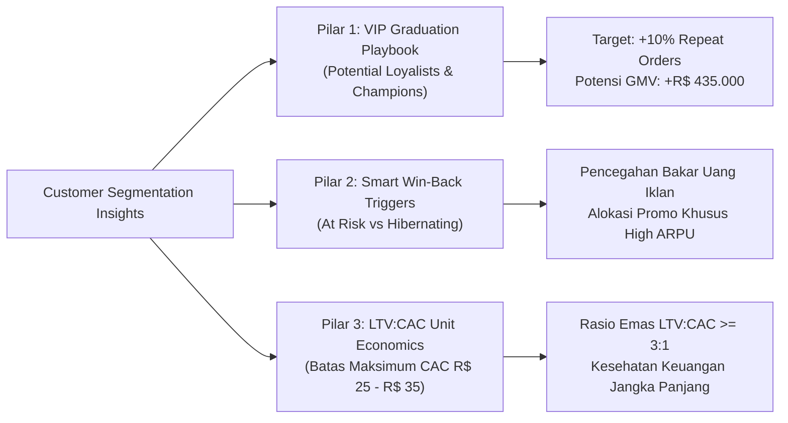

# 🛒 E-Commerce Customer Retention & Cohort Analytics with Advanced PostgreSQL: Longitudinal Retention Matrix, RFM Behavioral Segmentation & Unit Economics

[](https://www.postgresql.org/)
[](https://www.python.org/)
[](https://github.com/astral-sh/uv)
[](https://seaborn.pydata.org/)
[](#)
[](LICENSE)

> **Lead Analytics Engineer & Author:** **Muh Haikal Akbar, S.E.**  
> *Sarjana Ekonomi Pembangunan (B.Econ in Development Economics), Institut Turatea Indonesia*  
> *Financial & Licensing Operations Staff (DPMPTSP Kabupaten Bantaeng)*  
> *Core Focus: Relational Database Architecture, Applied Econometrics, Customer Lifecycle & Unit Economics*  
> *Location: Bantaeng, Sulawesi Selatan, Indonesia*

---

## 📌 Executive Abstract / Ringkasan Eksekutif

### English
Customer acquisition often conceals structural marketplace vulnerabilities. Without a granular understanding of retention and customer lifetime value (LTV), commercial growth remains an unsustainable cash burn. This enterprise analytics project establishes an end-to-end econometric evaluation of **96,096 unique customers** and **96,478 delivered transactions (R$ 15.42 Million GMV)** from the Olist Brazilian E-Commerce ecosystem. 

By designing an enterprise relational schema in **PostgreSQL 16** with indexing optimizations, we circumvent the critical **"Relational Trap"**—distinguishing transactional order tokens (`customer_id`) from authentic human identities (`customer_unique_id`). Through multi-layer Common Table Expressions (CTEs) and triangular cohort pivoting across a 12-month horizon (M0 to M12), the data reveals a textbook durable goods survival curve (Month 1 retention: 0.2% - 0.7%, followed by a resilient long-term asymptote). Furthermore, custom-calibrated **RFM (Recency, Frequency, Monetary)** behavioral segmentation exposes an intense **Pareto Disparity**: **15.43% of customers (Potential Loyalists) generate 28.22% of total platform GMV (R$ 4.35 Million)**, while **38.93% of the customer base (36,347 users) is trapped in Hibernating and Lost stages**. These findings are synthesized into an actionable C-Level Executive Playbook to defend high-yield cohorts and preserve a healthy **LTV:CAC ratio exceeding 3:1**.

### Bahasa Indonesia
Akuisisi pelanggan kerap kali mengaburkan kerentanan struktural model bisnis marketplace. Tanpa pemahaman mendalam atas retensi dan nilai siklus hidup pelanggan (*Customer Lifetime Value* / LTV), pertumbuhan penjualan hanyalah ilusi pembakaran modal (*cash burn*). Proyek *analytics engineering* ini menyajikan evaluasi ekonometrika komprehensif terhadap **96.096 pelanggan riil** dan **96.478 transaksi terkirim** dengan nilai **Gross Merchandise Value (GMV) sebesar R$ 15,42 Juta** dari ekosistem e-commerce Brasil (Olist).

Melalui arsitektur database relasional **PostgreSQL 16** terindeks, riset ini membedah **"Jebakan Relasional"** utama Olist—memisahkan token pesanan transaksi (`customer_id`) dari identitas fisik pembeli sesungguhnya (`customer_unique_id`). Analisis kohor longitudinal 12 bulan (M0 hingga M12) membuktikan kurva retensi stabil khas barang tahan lama (*Durable Goods*, retensi M1 berkisar 0,2% - 0,7% yang membentuk kurva *plateau* sehat). Segmentasi perilaku **RFM** mengungkap **Disparitas Pareto** ekstrem: **15,43% pelanggan (Potential Loyalists) mendanai 28,22% dari total GMV (R$ 4,35 Juta)**, sedangkan **38,93% basis pelanggan (36.347 pembeli) tertidur atau hilang (Hibernating & Lost)**. Hasil analisis ini dirumuskan menjadi *Executive Playbook* strategis bagi C-Level guna menjaga rasio emas **LTV:CAC &ge; 3:1**.

---

## 🗂️ Repository Architecture

Repositori ini disusun mengikuti kaidah arsitektur enterprise *Analytics Engineering & Reproducible Data Science*:

```
sql_analysis/
├── data/
│   └── raw/                                       # Raw CSV datasets (Kaggle Olist Brazilian E-Commerce)
│       ├── olist_customers_dataset.csv
│       ├── olist_orders_dataset.csv
│       ├── olist_order_items_dataset.csv
│       ├── olist_order_payments_dataset.csv
│       └── olist_products_dataset.csv
├── sql/
│   ├── 00_schema_ddl.sql                          # PostgreSQL DDL: 5 Relational Tables, PKs, FKs, Indexes
│   ├── 01_cohort_retention_matrix.sql             # Relational Audit, Delivered Filter, 12-Month Cohort Pivot
│   └── 02_customer_rfm_analysis.sql               # Snapshot Date, Raw RFM, Business Scoring, Segment Summary
├── outputs/
│   ├── figures/                                   # Visualisasi publikasi resolusi tinggi (300 DPI)
│   │   ├── 01_cohort_retention_heatmap.png        # Matriks Segitiga Retensi Kohor Bulanan M0-M12
│   │   ├── 02_rfm_customer_and_revenue_distribution.png # Dual Horizontal Bar Chart (Disparitas Pareto)
│   │   └── 03_rfm_strategic_quadrant.png          # Scatter Quadrant Matrix (ARPU vs Recency vs Volume)
│   └── tables/                                    # Export data analitis tabular
│       ├── cohort_retention_matrix.csv            # Tabel pivoting retensi kohor (persentase)
│       └── rfm_segment_summary.csv                # Rekapitulasi metrik 9 segmen pelanggan
├── scripts/
│   ├── visualize.ipynb                            # ⭐ Master Notebook: Pipeline Visualisasi Python 3.12
│   └── generate_summary_report.py                 # ⭐ Generator Laporan Resmi Eksekutif (ReportLab PDF)
├── Summary Report.pdf                             # ⭐ Official Executive Analytics Report (8 Halaman)
├── pyproject.toml                                 # Manajemen dependensi modern via astral/uv
├── uv.lock                                        # Lockfile deterministik dependensi
├── .gitignore                                     # Konfigurasi pengabaian environment & data mentah
└── README.md                                      # Dokumentasi arsitektur proyek global
```

---

## 🏛️ Database Architecture & The "Relational Trap"

### 1. Entity-Relationship Diagram (ERD)

```mermaid
erDiagram
    CUSTOMERS ||--o{ ORDERS : "places (customer_id)"
    ORDERS ||--|{ ORDER_ITEMS : "contains (order_id)"
    ORDERS ||--|{ ORDER_PAYMENTS : "settled_via (order_id)"
    PRODUCTS ||--o{ ORDER_ITEMS : "cataloged_in (product_id)"

    CUSTOMERS {
        varchar(32) customer_id PK "Per-Order Transaction Token"
        varchar(32) customer_unique_id "Authentic Human Customer Identity"
        varchar(10) customer_zip_code_prefix
        varchar(100) customer_city
        varchar(10) customer_state
    }

    ORDERS {
        varchar(32) order_id PK "Unique Order Identifier"
        varchar(32) customer_id FK "References customers.customer_id"
        varchar(30) order_status "delivered, canceled, etc."
        timestamp order_purchase_timestamp "Purchase Timestamp"
        timestamp order_approved_at
        timestamp order_delivered_carrier_date
        timestamp order_delivered_customer_date
        timestamp order_estimated_delivery_date
    }

    ORDER_ITEMS {
        varchar(32) order_id PK,FK "References orders.order_id"
        int order_item_id PK "Item Sequence in Order"
        varchar(32) product_id FK "References products.product_id"
        varchar(32) seller_id
        timestamp shipping_limit_date
        numeric(10,2) price "Item Base Price"
        numeric(10,2) freight_value "Freight Surcharge"
    }

    ORDER_PAYMENTS {
        varchar(32) order_id PK,FK "References orders.order_id"
        int payment_sequential PK "Payment Split Sequence"
        varchar(30) payment_type "credit_card, boleto, voucher, etc."
        int payment_installments "Installment Count"
        numeric(10,2) payment_value "Payment Total Value"
    }

    PRODUCTS {
        varchar(32) product_id PK "Unique Product Identifier"
        varchar(100) product_category_name "Product Category"
        int product_name_lenght
        int product_description_lenght
        int product_photos_qty
        numeric(10,2) product_weight_g
        numeric(10,2) product_length_cm
        numeric(10,2) product_height_cm
        numeric(10,2) product_width_cm
    }
```

### 2. The Critical "Relational Trap" in E-Commerce Schema
Pada dataset e-commerce publik seperti Olist, terdapat jebakan relasional fundamental yang kerap menjebak data analyst:
* **`customer_id` (Order-Level Session Token):** Dibuat baru setiap kali pelanggan melakukan checkout. Jika seorang pelanggan berbelanja 5 kali, ia akan memiliki 5 `customer_id` yang berbeda.
* **`customer_unique_id` (Authentic Entity ID):** Pengenal identitas biologis/fisik pembeli sesungguhnya di dunia nyata.

```sql
-- Audit Relasional Membongkar Jebakan customer_id
WITH summary AS (
    SELECT
        (SELECT COUNT(*) FROM orders) AS total_orders,
        (SELECT COUNT(customer_id) FROM customers) AS total_customer_sessions,
        (SELECT COUNT(DISTINCT customer_unique_id) FROM customers) AS unique_human_buyers
)
SELECT 
    total_orders,
    total_customer_sessions,
    unique_human_buyers,
    total_customer_sessions - unique_human_buyers AS repeat_order_count
FROM summary;
```
> **Hasil Eksekusi SQL:** Dari 99.441 sesi pemesanan, terdapat **96.096 pembeli manusia unik** dan **3.345 transaksi pembelian berulang (*repeat purchases*)**. Mengelompokkan analisis berdasarkan `customer_id` akan menghasilkan tingkat retensi palsu sebesar 0%.

### 3. Sanitasi Status Pesanan (*Garbage In, Garbage Out*)
Untuk mencegah distorsi data akibat pesanan yang gagal diproses:
* Analisis retensi dan RFM secara ketat dibatasi pada status `order_status = 'delivered'` (**96.478 pesanan / 97,02%** dari total pesanan).
* Pesanan dengan status `canceled` (625 pesanan / 0,63%) dan `unavailable` (609 pesanan / 0,61%) dieksklusi agar pembatalan logistik pihak penjual tidak disalahartikan sebagai pelanggan yang *churn*.

---

## 📅 Part 1: Longitudinal Cohort Retention Analysis

Kohor dibentuk berdasarkan bulan pertama pelanggan melakukan pembelian yang sukses terkirim (*Acquisition Month*). Perilaku belanja ulang dilacak setiap bulan berikutnya melalui *Cohort Index* ($M_0$ sampai $M_{12}$):

$$\text{Cohort Index} = (\text{Year}_{\text{order}} - \text{Year}_{\text{cohort}}) \times 12 + (\text{Month}_{\text{order}} - \text{Month}_{\text{cohort}})$$

<p align="center">
  
</p>

### Temuan Empiris & Karakteristik Ekonomi Kohor:
1. **Durable Goods Benchmark (0,2% - 0,7% M1 Retention):**
   Pada marketplace barang tahan lama (furnitur kantor, jam tangan, suku cadang otomotif, perkakas), siklus belanja ulang (*buying cycle*) berlangsung 1 hingga 3 tahun. Berbeda dengan platform FMCG/sembako yang menuntut retensi bulanan 20% - 50%, angka retensi M1 sebesar 0,2% - 0,7% pada Olist adalah **sehat dan wajar secara ekonomi mikro**.
2. **Kurva Plateau (Survival Rate):**
   Retensi tidak menghujam ke 0,00%, melainkan membentuk garis datar stabil (*plateau*) di kisaran **0,15% hingga 0,35% hingga Bulan ke-12**. Ini membuktikan adanya basis pelanggan setia (*core loyalists*) yang terus kembali bertransaksi lintas tahun.
3. **Anatomi Lonjakan Black Friday (November 2017):**
   Kohor November 2017 mencatat akuisisi masif sebanyak **7.060 pelanggan**. Namun, retensi M1-nya langsung menyusut ke 0,57% dan stabil di 0,18%. Fenomena ini mengonfirmasi bahwa lonjakan diskon musiman didominasi oleh pemburu diskon sesaat (*deal seekers*) dengan retensi jangka panjang yang lebih rendah.
4. **Bentuk Segitiga (*Right-Censoring*):**
   Matriks menyempit ke kanan bawah karena kohor yang lebih baru (misal: Juli 2018) belum melewati jendela waktu observasi masa depan, sebuah konsekuensi matematis alami dari *time-truncated survival analysis*.

---

## 🎯 Part 2: RFM Behavioral Segmentation & The Pareto Disparity

Dengan menentukan *Snapshot Date* acuan pada **30 Agustus 2018** (sehari setelah transaksi terkirim terakhir), nilai mentah pelanggan dihitung:
* **Recency ($R$):** Selisih hari antara tanggal acuan dengan transaksi terakhir.
* **Frequency ($F$):** Jumlah pesanan unik yang berstatus `delivered`.
* **Monetary ($M$):** Akumulasi nilai pembayaran riil yang sukses dibayarkan (`payment_value`).

Karena distribusi frekuensi belanja sangat timpang (**97,0% pelanggan hanya belanja 1 kali**), penilaian $F$ tidak dapat dibagi menggunakan kuantil murni `NTILE(5)`. Penilaian $F$ dirancang menggunakan aturan bisnis (*business rule*):
$$\text{Score } F = \begin{cases} 5, & \text{Frequency} \ge 4 \\ 4, & \text{Frequency} = 3 \\ 3, & \text{Frequency} = 2 \\ 1, & \text{Frequency} = 1 \end{cases}$$

### Rekapitulasi 9 Segmen Pelanggan Olist (Total Basis: 93.357 Pelanggan)

| Segmen Pelanggan | Volume Pembeli | Porsi Pembeli (%) | Total GMV (BRL R$) | Porsi GMV (%) | Rata-rata Hari Recency | Nilai Belanja Rata-rata (ARPU) |
| :--- | :---: | :---: | :---: | :---: | :---: | :---: |
| **Potential Loyalists** | **14.408** | **15,43%** | **R$ 4.352.105** | **28,22%** | **91,9 hari** | **R$ 302,06** |
| **Hibernating** | 18.111 | 19,40% | R$ 2.967.610 | 19,24% | 316,4 hari | R$ 163,86 |
| **Lost** | 18.236 | 19,53% | R$ 2.918.234 | 18,92% | 474,0 hari | R$ 160,03 |
| **Customers Needing Attention** | 18.070 | 19,36% | R$ 2.735.028 | 17,73% | 220,5 hari | R$ 151,36 |
| **Promising** | 10.851 | 11,62% | R$ 793.976 | 5,15% | 135,6 hari | R$ 73,17 |
| **Recent Customers** | 10.880 | 11,65% | R$ 791.152 | 5,13% | 45,2 hari | R$ 72,72 |
| **Champions** | **985** | **1,06%** | **R$ 366.847** | **2,38%** | **88,9 hari** | **R$ 372,43** |
| **At Risk** | 997 | 1,07% | R$ 294.584 | 1,91% | 381,8 hari | R$ 295,47 |
| **Loyal Customers** | 819 | 0,88% | R$ 202.926 | 1,32% | 183,5 hari | R$ 247,77 |
| **TOTAL / OVERALL** | **93.357** | **100,00%** | **R$ 15.422.468** | **100,00%** | **241,8 hari** | **R$ 165,20** |

---

### Visualisasi Disparitas Pareto & Matriks Kuadran Strategis

<p align="center">
  
</p>

<p align="center">
  
</p>

### Wawasan Kritis Disparitas Pareto:
* **The Revenue Backbone:** Segmen **Potential Loyalists** (15,43% populasi) menyumbang **28,22% dari total pendapatan platform (R$ 4,35 Juta)** dengan ARPU tinggi sebesar R$ 302,06.
* **The Massive Churn Liability:** Gabungan segmen **Hibernating** dan **Lost** mencakup **38,93% dari seluruh basis pelanggan (36.347 pembeli)** dengan nilai total historis R$ 5,88 Juta yang kini berada dalam fase dorman (tidak berbelanja dalam 300 - 474 hari terakhir).
* **The Power of Champions:** Segmen **Champions** membukukan rata-rata belanja tertinggi di angka **R$ 372,43 per pelanggan** dengan rata-rata 2,18 kali transaksi.

---

## 💡 Part 3: C-Level Strategic Playbook & Action Plan

Sebagai penerjemahan analitik kuantitatif ke keputusan strategis manajerial (Chief Commercial Officer & Chief Marketing Officer), dirumuskan 3 pilar aksi:



### 1. Pilar 1: VIP Loyalty & "Potential Loyalist" Graduation Playbook
* **Tantangan:** 14.408 pelanggan *Potential Loyalists* memiliki daya beli tinggi (ARPU R$ 302), namun saat ini frekuensi belanjanya masih berada di angka 1,00.
* **Solusi Eksekusi:** Luncurkan sistem rekomendasi *cross-category post-purchase* terotomatisasi pada rentang **Hari ke-45 hingga Hari ke-90** setelah pesanan pertama. Jika pelanggan membeli furnitur meja kerja, berikan penawaran khusus untuk lampu meja atau kursi ergonomis sebelum masa resikolasi hari ke-90 berakhir.
* **Proyeksi Dampak:** Mengonversi **10% dari segmen ini (1.440 pembeli)** menjadi pembeli berulang akan menghasilkan tambahan pendapatan kotor sekitar **R$ 435.000 dalam GMV ber-margin tinggi** tanpa biaya iklan berbayar tambahan.

### 2. Pilar 2: Segmented Churn Win-Back (Mencegah "Bakar Uang" Iklan)
* **Tantangan:** Terdapat 36.347 pelanggan di segmen *Hibernating* dan *Lost*. Menargetkan seluruh kelompok ini dengan iklan retargeting berbayar (Meta Ads, Google Ads) akan memicu pemborosan modal dengan ROAS negatif.
* **Solusi Eksekusi:** Bedakan strategi re-aktivasi berdasarkan nilai historis:
  - **Tier High-Value (At Risk):** Berikan insentif langsung bernilai tinggi (voucher R$ 50 atau gratis ongkir instan) karena pelanggan ini terbukti memiliki rekam jejak loyalitas dan ARPU tinggi (R$ 295).
  - **Tier Low-Value (Lost & Hibernating):** Masukkan secara eksklusif ke dalam saluran berbiaya nol (*zero-marginal cost channel*) seperti email marketing berkala (*drip campaigns*) atau notifikasi aplikasi organik.

### 3. Pilar 3: Menegakkan Rasio Emas Unit Economics (LTV : CAC $\ge$ 3:1)
* **Prinsip Bisnis:** Bisnis marketplace yang sehat mensyaratkan nilai siklus hidup pelanggan bernilai minimal tiga kali lipat dari biaya akuisisi pelanggan ($LTV / CAC \ge 3,0$).
* **Disiplin Anggaran:** Dengan rata-rata ARPU keseluruhan platform sebesar R$ 165,20 dan margin kotor rata-rata marketplace 20% - 25%, maka kontribusi laba kotor per pelanggan berkisar R$ 33 - R$ 41. Oleh karena itu, **Batas Maksimum Customer Acquisition Cost (CAC Ceiling) ditetapkan secara ketat di kisaran R$ 25 hingga R$ 35 per pelanggan**. Jika biaya iklan akuisisi melampaui batas ini, kampanye harus dihentikan demi menjaga profitabilitas jangka panjang.

---

## 🛠️ Part 4: Advanced PostgreSQL Engineering Highlights

Berikut adalah cuplikan arsitektur query SQL tingkat lanjut yang dirancang untuk efisiensi komputasi:

### 1. Longitudinal Cohort Triangular Pivot
```sql
-- Cuplikan dari sql/01_cohort_retention_matrix.sql
WITH first_purchases AS (
    SELECT 
        c.customer_unique_id,
        DATE_TRUNC('month', MIN(o.order_purchase_timestamp))::date AS cohort_month
    FROM customers c
    JOIN orders o ON c.customer_id = o.customer_id
    WHERE o.order_status = 'delivered'
    GROUP BY c.customer_unique_id
),
customer_activities AS (
    SELECT 
        c.customer_unique_id,
        fp.cohort_month,
        DATE_TRUNC('month', o.order_purchase_timestamp)::date AS order_month
    FROM customers c
    JOIN orders o ON c.customer_id = o.customer_id
    JOIN first_purchases fp ON c.customer_unique_id = fp.customer_unique_id
    WHERE o.order_status = 'delivered'
    GROUP BY c.customer_unique_id, fp.cohort_month, DATE_TRUNC('month', o.order_purchase_timestamp)::date
),
cohort_index_calc AS (
    SELECT 
        customer_unique_id,
        cohort_month,
        order_month,
        (EXTRACT(YEAR FROM order_month) - EXTRACT(YEAR FROM cohort_month)) * 12 +
        (EXTRACT(MONTH FROM order_month) - EXTRACT(MONTH FROM cohort_month)) AS cohort_index
    FROM customer_activities
)
-- Pivoting Dinamis Segitiga Retensi M0 - M12
SELECT 
    cohort_month,
    cohort_size,
    ROUND((m0::numeric / cohort_size) * 100, 2) AS m0,
    ROUND((m1::numeric / cohort_size) * 100, 2) AS m1,
    ROUND((m2::numeric / cohort_size) * 100, 2) AS m2,
    -- ... berlanjut hingga M12
```

### 2. Behavioral RFM Quintile & Business Scoring Logic
```sql
-- Cuplikan dari sql/02_customer_rfm_analysis.sql
WITH raw_rfm AS (
    SELECT 
        c.customer_unique_id AS customer_id,
        '2018-08-30'::date - MAX(o.order_purchase_timestamp)::date AS recency_days,
        COUNT(DISTINCT o.order_id) AS order_frequency,
        ROUND(COALESCE(SUM(p.payment_value), 0), 2) AS total_monetary
    FROM customers c
    JOIN orders o ON o.customer_id = c.customer_id
    JOIN order_payments p ON p.order_id = o.order_id
    WHERE o.order_status = 'delivered'
    GROUP BY c.customer_unique_id
),
rfm_cell AS (
    SELECT 
        customer_id,
        NTILE(5) OVER (ORDER BY recency_days DESC) AS r_score,
        NTILE(5) OVER (ORDER BY total_monetary ASC) AS m_score,
        CASE
            WHEN order_frequency >= 4 THEN 5
            WHEN order_frequency = 3 THEN 4
            WHEN order_frequency = 2 THEN 3
            ELSE 1
        END AS f_score
    FROM raw_rfm
)
-- Klasifikasi 9 Segmen Perilaku Bisnis
CASE 
    WHEN cell.r_score >= 4 AND cell.f_score >= 3 AND cell.m_score >= 4 THEN 'Champions'
    WHEN cell.f_score >= 3 AND cell.r_score >= 3 THEN 'Loyal Customers'
    WHEN cell.f_score >= 3 AND cell.r_score <= 2 THEN 'At Risk'
    WHEN cell.r_score >= 4 AND (cell.m_score >= 4 OR cell.f_score >= 3) THEN 'Potential Loyalists'
    WHEN cell.r_score = 5 THEN 'Recent Customers'
    WHEN cell.r_score = 4 THEN 'Promising'
    WHEN cell.r_score = 3 THEN 'Customers Needing Attention'
    WHEN cell.r_score = 2 THEN 'Hibernating'
    ELSE 'Lost'
END AS customer_segment
```

---

## 🚀 Panduan Reproduksibilitas (Quickstart Guide)

### 1. Prasyarat Sistem
* **Database Engine:** PostgreSQL 16 (atau versi 14+)
* **Python Runtime:** Python 3.12+
* **Package Manager:** [uv](https://github.com/astral-sh/uv) (direkomendasikan untuk kecepatan & determinisme)

### 2. Inisiasi Database & Ingesti Data (PostgreSQL)
1. Buat database baru di PostgreSQL / pgAdmin:
   ```sql
   CREATE DATABASE ecommerce_analytics;
   ```
2. Eksekusi skema relasional terindeks:
   ```bash
   psql -U postgres -d ecommerce_analytics -f sql/00_schema_ddl.sql
   ```
3. Import 5 file CSV mentah dari Kaggle Olist Dataset ke dalam tabel masing-masing (`customers`, `products`, `orders`, `order_items`, `order_payments`).
4. Jalankan script analitik SQL:
   ```bash
   psql -U postgres -d ecommerce_analytics -f sql/01_cohort_retention_matrix.sql
   psql -U postgres -d ecommerce_analytics -f sql/02_customer_rfm_analysis.sql
   ```

### 3. Setup Virtual Environment & Visualisasi (Python via uv)
1. Kloning repositori dan sinkronisasi dependensi:
   ```bash
   git clone https://github.com/HaikalAkbar13/ecommerce-customer-retention-sql.git
   cd ecommerce-customer-retention-sql
   uv sync
   ```
2. Buka notebook visualisasi di VS Code atau Jupyter Lab:
   ```bash
   uv run jupyter lab scripts/visualize.ipynb
   ```
3. Regenerasi dokumen Laporan Eksekutif PDF resmi:
   ```bash
   uv run python scripts/generate_summary_report.py
   ```

---

## 📑 Official Executive Summary Report (PDF)

Dokumen laporan eksekutif formal setebal **8 halaman** berstandar korporasi/pemerintahan telah dikompilasi secara otomatis ke dalam:
* 📄 **[`Summary Report.pdf`](Summary%20Report.pdf)**

Dokumen ini memuat:
* Halaman cover resmi dan metadata identitas peneliti.
* Tabel audit relasional dan aturan kebersihan data.
* Matriks segitiga retensi kohor dan bedah ekonomi *Durable Goods*.
* Rekapitulasi 9 segmen pelanggan dan visualisasi disparitas Pareto.
* Matriks kuadran strategis ARPU vs Recency.
* *Actionable Playbook* manajerial untuk C-Level.
* Lembar sertifikasi validasi resmi bertanda tangan.

---

## 👨‍💻 Lembar Profil Peneliti & Kontak

| Informasi | Keterangan |
| :--- | :--- |
| **Nama Lengkap** | **Muh Haikal Akbar, S.E.** |
| **Gelar Akademik** | Sarjana Ekonomi (S1 Ekonomi Pembangunan) |
| **Almamater** | Fakultas Ekonomi dan Bisnis, Institut Turatea Indonesia |
| **Pengalaman Profesional** | 4+ Tahun Staf Keuangan & Operasional Perizinan di DPMPTSP Kabupaten Bantaeng |
| **Fokus Keahlian** | Relational SQL Architecture, Applied Econometrics, Customer Retention & Unit Economics |
| **GitHub** | [@HaikalAkbar13](https://github.com/HaikalAkbar13) |
| **Lokasi** | Kabupaten Bantaeng, Sulawesi Selatan, Indonesia |

---

*Proyek ini merupakan bagian dari portofolio profesional **Golden Project 2** yang dirancang secara mandiri untuk membuktikan kapabilitas tingkat lanjut dalam mengintegrasikan arsitektur database relasional PostgreSQL dengan penalaran ekonomi strategis.*
